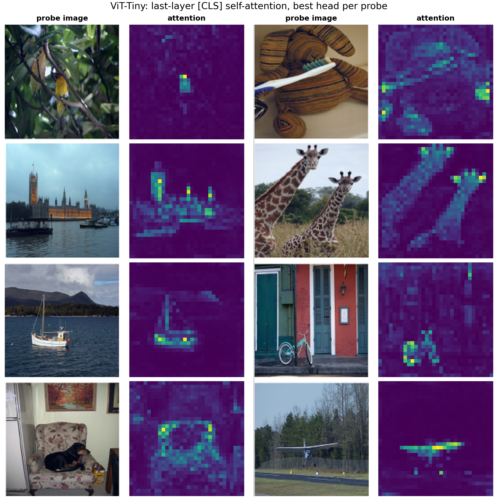
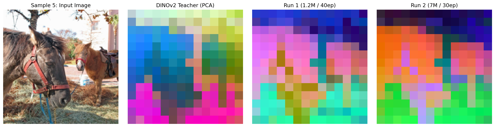

# ViT-Tiny/16 Distilled from DINOv2 on DataComp-12M

[](https://huggingface.co/hasanfaesal/vit-tiny-patch16-224-dinov2-distill)
[](LICENSE)
[](https://pytorch.org/)

Self-supervised feature distillation of a frozen **DINOv2 ViT-S/14 (`dinov2_vits14_reg`, 21.8M params)** teacher into a **5.7M-parameter ViT-Tiny/16 (`vit_tiny_patch16_224`)** trained **from scratch** on up to **5.94M images from DataComp-12M** on a single NVIDIA H100 — with no ImageNet supervision and no pretrained initialization.

**Key idea — exact 14×14 patch-grid matching:** feeding the student 224×224 images (patch size 16 → 14×14 = 196 tokens) and the teacher the same views resized to 196×196 (patch size 14 → 14×14 = 196 tokens) creates a **1-to-1 spatial correspondence** between every student and teacher patch token. Because the teacher is frozen, direct cosine regression on `[CLS]` and patch tokens requires no token interpolation, no centering/sharpening, and no attention-map matching.


*Last-layer `[CLS]` self-attention of the distilled ViT-Tiny (Run 2) without any segmentation or detection supervision.*

---

## Quickstart (Pretrained Weights)

Pretrained backbones and full student checkpoints (with projection heads) are published on Hugging Face as `safetensors` at [`hasanfaesal/vit-tiny-patch16-224-dinov2-distill`](https://huggingface.co/hasanfaesal/vit-tiny-patch16-224-dinov2-distill):

```python
import timm
import torch
from timm.data import create_transform, resolve_data_config

model = timm.create_model(
    "hf-hub:hasanfaesal/vit-tiny-patch16-224-dinov2-distill",
    pretrained=True,
).eval()

cfg = resolve_data_config({}, model=model)  # uses ImageNet mean/std from config.json
transform = create_transform(**cfg)

x = torch.randn(2, 3, 224, 224)
with torch.no_grad():
    feats = model.forward_features(x)  # [2, 197, 192]
    cls_token = feats[:, 0]            # [2, 192]
    patch_tokens = feats[:, 1:]        # [2, 196, 192]
```

---

## Empirical Results

We compare two data-scale regimes against the frozen teacher under identical evaluation protocols (L2-normalized `[CLS]` features; $k$-NN with $k=20, T=0.07$; 15-epoch SGD linear probes; Pascal VOC 2012 14×14 patch linear probe):

| Benchmark | Metric | Run 1 (1.22M / 40 ep) | **Run 2 (5.94M / 30 ep)** | Teacher (`dinov2_vits14_reg`) |
|---|---|---:|---:|---:|
| **CIFAR-100** | $k$-NN Top-1 ($k=20$) | 75.50% | **76.25%** | 84.12% |
| **CIFAR-100** | Linear Probe Top-1 | 65.72% | **66.97%** | 79.48% |
| **Imagenette** | $k$-NN Top-1 ($k=20$) | 97.58% | **97.83%** | 99.41% |
| **Imagenette** | Linear Probe Top-1 | 95.69% | **95.90%** | 98.55% |
| **Pascal VOC 2012** | Patch Linear Probe mIoU | **56.97%** | 56.41% | 68.23% |
| **Pascal VOC 2012** | Patch Pixel Accuracy | **89.19%** | 89.13% | 92.12% |
| **Alignment** | Linear CKA vs. Teacher | 0.6977 | 0.6971 | 1.0000 |
| **Geometry** | Effective Rank ($\text{ER} / D$) | 153.6 (0.800) | 151.7 (0.790) | 335.3 (0.873) |
| **Geometry** | Pairwise Cosine Anisotropy ↓ | 0.2387 | **0.1606** | 0.1090 |

**Key observations:**
- **Dense transfer at 4× fewer parameters:** Direct 14×14 patch cosine regression transfers **>82% of the teacher's VOC segmentation probe mIoU** (56.97% vs. 68.23%) using a 5.7M-parameter ViT-Tiny.
- **Data diversity reduces representation anisotropy:** Scaling from 1.22M to 5.94M unique images cuts mean pairwise cosine similarity by **32.7%** (0.2387 → 0.1606, approaching the teacher's 0.1090) while both runs converge to nearly the same manifold (Run 1 vs. Run 2 Linear CKA = **0.9010**).


*3-component PCA of 14×14 patch tokens on Pascal VOC 2012: Input image, frozen DINOv2 teacher, Run 1 student, and Run 2 student.*

---

## Method

- **Teacher:** `facebookresearch/dinov2` (`dinov2_vits14_reg`, 384-dim, 4 register tokens), frozen in `bfloat16`, input resized bicubic to 196×196.
- **Student:** `timm` `vit_tiny_patch16_224` (192-dim, 12 blocks, 3 heads, 5.7M params), random init, `bfloat16` autocast + `torch.compile(mode="reduce-overhead")`, input 224×224.
- **Projection heads:**
  - `cls_head`: `Linear(192, 1024) → GELU → Linear(1024, 384)`
  - `patch_head`: `Linear(192, 384)`
- **Objective:**

$$\mathcal{L} = \underbrace{1 - \cos\big(\mathrm{cls\_head}(S_{\text{cls}}),\, T_{\text{cls}}\big)}_{\mathcal{L}_{\text{cls}}} + \lambda \cdot \underbrace{\frac{1}{196}\sum_{i=1}^{196}\Big(1 - \cos\big(\mathrm{patch\_head}(S^{(i)}),\, T^{(i)}\big)\Big)}_{\mathcal{L}_{\text{patch}}}, \quad \lambda = 1.0$$

- **Augmentations & Optimization:** 2 global 224×224 views per image (random resized crop `0.4–1.0`, horizontal flip, color jitter `p=0.8`, Gaussian blur `p=0.5`, solarization `p=0.2`); AdamW (`lr=1e-3`, `weight_decay=0.05`, linear warmup + cosine decay, grad clip `3.0`), batch size 256 images (512 views) on 1× NVIDIA H100 80GB SXM5 (~12.4 h wall-clock for Run 2).

---

## Reproducing Training & Evaluation

### 1. Install dependencies
```bash
pip install -r requirements.txt
```

### 2. Fetch DataComp-12M WebDataset shards
DataComp-12M on Hugging Face provides URL metadata; images are fetched into WebDataset `.tar` shards via `img2dataset`:
```bash
pip install img2dataset
bash scripts/fetch_images.sh 0 170 data/images
```

### 3. Train
```bash
# Run 1 (1.22M images, 40 epochs)
python src/train.py --config configs/distill_config.yaml

# Run 2 (5.94M images, 30 epochs with k-NN + loss early-stopping)
python src/train.py --config configs/distill_full.yaml

# Quick 2-epoch smoke test on 8 shards
python src/train.py --config configs/distill_config.yaml --smoke
```

### 4. Evaluate & Visualize
```bash
# Full evaluation suite (CIFAR-100, Imagenette, CKA/ER/anisotropy, Pascal VOC)
python src/evaluate.py \
  --models run2=hf-hub:hasanfaesal/vit-tiny-patch16-224-dinov2-distill \
  --teacher \
  --benchmarks cifar100 imagenette geometry voc \
  --out-dir eval_out

# Fast CIFAR-100 k-NN check on local checkpoints
python src/evaluate_knn.py checkpoints/run2/best_knn.pt --teacher

# Side-by-side Teacher vs. Student 14x14 patch PCA maps
python src/visualize_pca.py \
  --checkpoint hf-hub:hasanfaesal/vit-tiny-patch16-224-dinov2-distill \
  --out-dir visualizations
```

---

## Repository Layout

```text
├── assets/                     # Curated figures for README
├── configs/
│   ├── distill_config.yaml     # Run 1 config (1.22M images, 40 epochs)
│   └── distill_full.yaml       # Run 2 config (5.94M images, 30 epochs)
├── scripts/
│   ├── build_urls.py           # Extract URL parquet from DataComp metadata tars
│   ├── download_data.sh        # Resumable DataComp-12M metadata downloader
│   ├── fetch_images.sh         # img2dataset WebDataset shard builder
│   └── run_training.sh         # Resumable training launcher
├── src/
│   ├── dataset.py              # WebDataset loader & 2-view global augmentation pipeline
│   ├── models.py               # Frozen DINOv2 teacher, ViT-Tiny student & projection heads
│   ├── losses.py               # Cosine CLS + 14x14 patch distillation loss
│   ├── train.py                # BF16 + torch.compile training loop with online k-NN
│   ├── evaluate_knn.py         # Standalone CIFAR-100 k-NN evaluator
│   ├── evaluate.py             # Full benchmark suite (k-NN, linear probe, CKA, ER, VOC)
│   └── visualize_pca.py        # Teacher vs. student 14x14 patch PCA renderer
├── LICENSE
└── requirements.txt
```

---

## Limitations

- Metrics are reported from a **single seed per run** on CIFAR-100, Imagenette, and Pascal VOC 2012 (not full ImageNet-1k).
- Published weights are feature extractors (`num_classes=0`) with no classification head.
- Training data consists of web-scraped DataComp-12M subsets; teacher biases from DINOv2 may transfer to the student.

---

## Citation

```bibtex
@software{faesal2026dinov2tinydistill,
  author = {Hasan Faesal},
  title  = {ViT-Tiny/16 Distilled from DINOv2 on DataComp-12M},
  year   = {2026},
  url    = {https://github.com/hasanfaesal/dinov2-tiny-distill}
}

@article{oquab2024dinov2,
  title   = {DINOv2: Learning Robust Visual Features without Supervision},
  author  = {Oquab, Maxime and Darcet, Timoth{\'e} and Moutakanni, Huy and Vo, Huy V. and Szafraniec, Marc and Khalidov, Vasil and Fernandez, Pierre and Haziza, Daniel and Massa, Francisco and El-Nouby, Alaa and Assran, Mahmoud and Ballas, Nicolas and Galuba, Wojciech and Howes, Russell and Huang, Po-Yao and Li, Shang-Wen and Misra, Ishan and Rabbat, Michael and Sharma, Vasu and Synnaeve, Gabriel and Xu, Hu and Jegou, Herv{\'e} and Mairal, Julien and Labatut, Patrick and Joulin, Armand and Bojanowski, Piotr},
  journal = {Transactions on Machine Learning Research},
  year    = {2024}
}

@inproceedings{gadre2023datacomp,
  title     = {DataComp: In search of the next generation of multimodal datasets},
  author    = {Gadre, Samir Yitzhak and Ilharco, Gabriel and Fang, Alex and Hayase, Jonathan and Smyrnis, Georgios and Nguyen, Thao and Marten, Ryan and Wortsman, Mitchell and Ghosh, Dhruba and Zhang, Jieyu and Orgad, Eyal and Entezari, Rahim and Daras, Giannis and Pratt, Sarah and Ramanujan, Vivek and Bitton, Yonatan and Marathe, Kalyani and Mussmann, Stephen and Vencu, Richard and Cherti, Mehdi and Krishna, Ranjay and Koh, Pang Wei and Saukh, Olga and Ratner, Alexander and Song, Shuran and Hajishirzi, Hannaneh and Farhadi, Ali and Beaumont, Romain and Oh, Sewoong and Dimakis, Alex and Jitsev, Jenia and Carmon, Yair and Shankar, Vaishaal and Schmidt, Ludwig},
  booktitle = {NeurIPS Datasets and Benchmarks},
  year      = {2023}
}
```
